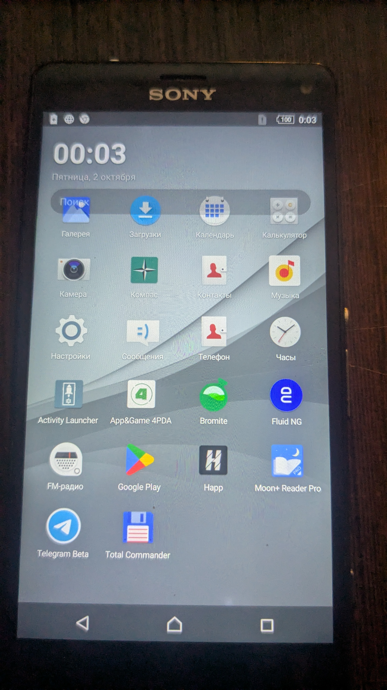

# SimpleLauncher

A 37 KB home screen for Android 5.0 through 17. No permissions. No news feed.
No widgets, folders, pages or gestures. Just your apps, in alphabetical order,
over your wallpaper — plus a clock and a search field that actually searches
your phone.


*First field deployment, v1.1 on a Sony Xperia Z3 Compact (Android 6.0.1).
The header overlap visible in this early photo was fixed in v1.2.*

## Why this exists

It was written for a 2014 phone that could not run any modern launcher:
every candidate either crashed on missing framework classes or demanded
Android 8+. So this one targets **API 21** in its legacy flavor and uses
nothing newer, while a second flavor targets **API 35** for current devices —
same source, two builds.

## Features

- Grid of every launchable app (4 columns), sorted A→Z by default
- Alphabet index bar on the right: `#`, `A–Z`, `А–Я` — tap or drag to jump;
  English- and Russian-named apps live in one consistent order. When
  sections outnumber readable slots, the bar paints every N-th letter but
  touch still maps to all of them
- Live search over installed apps (label or package name, any language,
  case-insensitive); the keyboard's search key launches the top local hit,
  or falls back to a web query when nothing matched on the device
- Clock and date over the system wallpaper; translucent system bars
- Long-press an app: app info / uninstall
- Long-press the clock: sort mode (6 options), hide/show search,
  reload list, **switch default launcher** (easy exit back to stock)
- Work profile support: badged icons, per-profile launch and app-info,
  quiet profiles skipped
- List refreshes itself when packages are installed or removed, in any profile

## Non-features (deliberate)

No pages, docks, widgets, folders, themes, icon packs, gestures, clouds,
accounts, analytics, ads or network access. The manifest declares
**zero permissions**.

## Flavors

| | legacy | modern |
|---|---|---|
| `minSdk` | 21 | 21 |
| `targetSdk` | 23 | 35 |
| for | Android 5–7, old devices (Xperia Z3 Compact et al.) | Android 8+, current devices (Pixel 6a et al.) |
| notes | avoids runtime-permission and package-visibility regimes entirely | `<queries>` for package visibility on 11+, `RECEIVER_NOT_EXPORTED` under SDK guard, edge-to-edge |

Both flavors are built from the same source by `build.sh`.

## Install

Prebuilt APKs are attached to [Releases](../../releases). Then either let
Android ask you to pick a home app, or:

```
adb install -r SimpleLauncher-legacy.apk
adb shell cmd package set-home-activity ru.simplelauncher/.HomeActivity
```

To leave: long-press the clock → *Switch default launcher…*

## Build

### Without Gradle (fast, no Android Studio)

Requires JDK 11+ and an Android SDK with `build-tools;35.0.0` +
`platforms;android-35` (modern flavor) and `build-tools;34.0.0` +
`platforms;android-34` (legacy flavor):

```
export ANDROID_HOME=/path/to/android-sdk
bash build.sh legacy     # -> SimpleLauncher-legacy.apk  (targetSdk 23)
bash build.sh modern     # -> SimpleLauncher-modern.apk  (targetSdk 35)
```

> **Signing warning.** The keystore is deliberately NOT in this repository.
> A build from a fresh clone creates its own key, and its APK will NOT
> install as an update over an existing installation
> (`INSTALL_FAILED_UPDATE_INCOMPATIBLE`). If you track a deployment on a
> device, keep one keystore forever and pass it via `KEYSTORE=/path/key.jks`.

The script runs `aapt2 compile` → `aapt2 link` → `javac` → `d8` →
`zipalign` → `apksigner`. A signing keystore is created on first run at
`keystore/simplelauncher.jks` (outside `build/`, so rebuilds keep the same
key). **Keep it** if you intend to ship updates: Android refuses to update an
APK signed with a different key.

### With Gradle / Android Studio

Open the folder as a project and build as usual (`app/build.gradle`,
AGP 8.6, Gradle 8.7 wrapper properties included).

## Project layout

```
app/src/main/java/ru/simplelauncher/
    HomeActivity.java   screen, clock, search, menus, package loading
    AppAdapter.java     GridView adapter; item views built in code
    AppItem.java        one row: label, component, user, section, icon
    IndexBar.java       the #-A-Z-А-Я fast-scroll bar
app/src/main/res/       layout, strings (RU), colors, icon PNGs
build.sh                no-Gradle build, two flavors
.github/workflows/      CI: builds both APKs on every push
```

## Companion tools

The session-born sibling project [android-debloat-tools](https://github.com/tdk000/android-debloat-tools)
holds the no-root debloat/inspection toolkit referenced in the changelog
(profiles, safety rails, field lessons).

## Privacy

The app declares no permissions and contains no tracking code. It reads the
list of launchable activities through the sanctioned launcher APIs
(`LauncherApps`, `UserManager`) and nothing else.

## License

GPL-3.0-only. See [LICENSE](LICENSE).
